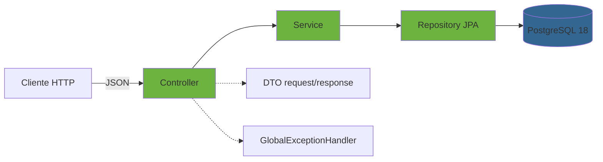

# 📚 Biblioteca Santa Lucía

[](https://openjdk.org/)
[](https://spring.io/projects/spring-boot)
[](https://github.com/erinnodarse23/backend-biblioteca-santa-lucia/actions/workflows/ci.yml)
[](https://spring.io/)
[](https://hibernate.org/)
[](https://www.postgresql.org/)
[](https://swagger.io/)
[-brightgreen?style=flat-square)](#-tests)
[](LICENSE)

API REST para gestión bibliotecaria: control de libros, autores, géneros, usuarios, préstamos y reseñas. Proyecto de **fundamentos** reestructurado para portafolio, donde consolidé modelado relacional, JPA, reglas de negocio, validación y testing. Corre con **Java 25 + Spring Boot 4.1 + PostgreSQL 18**.

**Proyecto complementario a [telefonia-ecasa](https://github.com/erinnodarse23/telefonia-ecasa)** — ver [Contexto](#-contexto) para entender la relación.

---

## 🎯 Contexto

Este proyecto nació como trabajo académico de 2º año (periodo 2024-2025) para la asignatura de Bases de Datos. Fue reestructurado completamente para portafolio: stack actualizado a las últimas versiones LTS, tests, Docker, smoke tests E2E y buenas prácticas de producción.

Su rol en el portafolio es mostrar los **fundamentos** sobre los que se construyó después un sistema empresarial más grande:

| Este proyecto | [telefonia-ecasa](https://github.com/erinnodarse23/telefonia-ecasa) |
|---|---|
| Fundamentos: JPA, modelado, validación, testing | Producción: JWT, rate limiting, analytics, RBAC |
| CRUD + 5 reglas de negocio | 14 controllers, 20+ services, dashboard |
| 51 tests (16 unit + 35 E2E) | 92 tests (backend + frontend) |
| PostgreSQL 18 local | PostgreSQL gestionado en ZevCloud |
| Docker Compose para dev | Docker + Render + CI/CD |

**Qué sí demuestra:** modelado relacional, JPA/Hibernate, Bean Validation, Spring Data, diseño de API REST, manejo centralizado de errores, testing de servicios y controllers, migración de stack mayor (Spring Boot 3 → 4, Java 17 → 25, PG 10 → 18).

**Qué no intenta ser:** un sistema de producción con autenticación, rate limiting o dashboards — eso está en ecasa.

---

## 🛠️ Stack técnico

### Backend

| Tecnología | Versión | Uso |
|---|---|---|
| **Java** | 25 LTS | Lenguaje (Virtual Threads, Pattern Matching) |
| **Spring Boot** | 4.1.2 | Framework principal |
| **Spring Framework** | 7.0.10 | Núcleo MVC, DI |
| **Spring Data JPA** | 4.1.2 | Persistencia |
| **Hibernate ORM** | 7.4.13 | ORM |
| **Tomcat** | 11.0.27 | Servidor embebido |
| **Jackson** | 3.1.7 | Serialización JSON |
| **Springdoc OpenAPI** | 3.0.3 | Swagger UI + OpenAPI 3.1 |
| **PostgreSQL Driver** | 42.7.13 | JDBC |
| **Lombok** | 1.18.44 | Reducción de boilerplate |
| **Maven** | 3.9+ | Build tool |

### Infraestructura

| Servicio | Uso |
|---|---|
| **PostgreSQL 18.6** | Base de datos relacional |
| **Docker Compose** | Entorno local reproducible |

---

## 🏗️ Arquitectura



### Estructura del proyecto

```text
backend-biblioteca-santa-lucia/
├── .mvn/
│   └── maven.config              # Timeouts + retries para redes inestables
├── .vscode/
│   └── settings.json             # Java 25 + null analysis off
├── scripts/
│   ├── tablas.sql                # Schema + 7 índices
│   ├── operaciones.sql           # Consultas de ejemplo
│   └── smoke-test.ps1            # Smoke test E2E (35 asserts)
├── src/main/
│   ├── java/com/biblioteca/springbiblioteca/
│   │   ├── controller/           # 6 controllers REST
│   │   ├── dto/                  # request/ + response/ (records)
│   │   ├── entity/               # 6 entidades JPA
│   │   ├── exception/            # GlobalExceptionHandler + errores custom
│   │   ├── mapper/               # LibroMapper
│   │   ├── repository/           # 6 repositorios JpaRepository
│   │   ├── service/              # 4 services con reglas de negocio
│   │   └── SpringBibliotecaApplication.java
│   └── resources/
│       ├── application.properties           # config base
│       ├── application-dev.properties       # SQL logging
│       ├── application-prod.properties      # ddl-auto=validate
│       └── application-local.properties.example
├── src/test/java/...             # 3 test classes (16 tests)
└── pom.xml
```

---

## 🎯 Funcionalidades destacadas

### Gestión bibliotecaria
- 📖 **Libros** con ISBN, título, año, categoría, cantidad de ejemplares
- ✍️ **Autores** con relación 1:N a libros
- 🏷️ **Géneros** con relación 1:N a libros
- 👤 **Usuarios** con email único y datos de contacto
- 🔄 **Préstamos** con fecha de salida/devolución y estado
- ⭐ **Reseñas** con calificación 1-5 y comentario único por usuario+libro

### Reglas de negocio (validadas en `Service`)
- 🚫 Un usuario no puede tener más de **5 préstamos activos** simultáneos
- 🚫 Un usuario **con préstamos vencidos** no puede pedir nuevos
- 🚫 No se presta un libro **sin ejemplares disponibles**
- 🚫 **Una reseña por usuario/libro** (validado también con `UNIQUE` en BD)
- 🚫 Solo se puede reseñar un libro que **ya fue devuelto**

### Calidad de código
- ✅ **Bean Validation** en DTOs (`@NotBlank`, `@Size`, `@Pattern`, `@Positive`)
- 🚨 **GlobalExceptionHandler** con `@ControllerAdvice`: 400 (validación), 404 (no encontrado), 409 (regla de negocio o integridad), 500 (sin leaks)
- 🛡️ **409 para FK violations** sin filtrar detalles técnicos al cliente
- 🗄️ **SQL versionado** con schema + seed + 7 índices (incluye índice parcial para préstamos activos)
- 🧪 **51 tests**: 16 unitarios (JUnit 5 + Mockito) + 35 asserts E2E

---

## 🚀 Quick Start

### Requisitos
- Java 25 LTS ([Temurin](https://adoptium.net/))
- Maven 3.9+
- PostgreSQL 18
- PowerShell 5.1+ (Windows) o bash (Linux/macOS)

### Opción 1 — PowerShell (Windows, recomendado)

```powershell
git clone https://github.com/erinnodarse23/backend-biblioteca-santa-lucia.git
cd backend-biblioteca-santa-lucia

# 1. Configurar credenciales locales
Copy-Item "src\main\resources\application-local.properties.example" `
          "src\main\resources\application-local.properties"
# Edita application-local.properties y pon tu password de PostgreSQL

# 2. Crear BD y aplicar schema
psql -h localhost -p 5432 -U postgres -c "CREATE DATABASE biblioteca_santa_lucia;"
psql -h localhost -p 5432 -U postgres -d biblioteca_santa_lucia -f scripts/tablas.sql

# 3. Ejecutar
mvn spring-boot:run
```

La app queda en:
- API: `http://localhost:8080`
- Swagger UI: `http://localhost:8080/swagger-ui/index.html`
- OpenAPI JSON: `http://localhost:8080/v3/api-docs`

### Opción 2 — Docker Compose

```bash
git clone https://github.com/erinnodarse23/backend-biblioteca-santa-lucia.git
cd backend-biblioteca-santa-lucia
docker compose up -d
```

### Variables de entorno / perfiles

| Variable | Default | Uso |
|---|---|---|
| `DB_PASSWORD` | (vacío) | Password de PostgreSQL. En local se toma de `application-local.properties`. En prod/CI se sobreescribe con variable de entorno |
| `SPRING_PROFILES_ACTIVE` | `default` | `dev` para SQL logging, `prod` para `ddl-auto=validate` |

---

## 📚 API Documentation

Swagger UI disponible en `http://localhost:8080/swagger-ui/index.html` con OpenAPI 3.1.

### Endpoints principales

| Módulo | Endpoints |
|---|---|
| **Autores** | `GET/POST /api/autores` · `GET/PUT/DELETE /api/autores/{id}` |
| **Géneros** | `GET/POST /api/generos` · `GET/PUT/DELETE /api/generos/{id}` |
| **Libros** | `GET/POST /api/libros` · `GET/PUT/DELETE /api/libros/{isbn}` · `GET /api/libros/{isbn}/detalle` · `GET /api/libros/{isbn}/prestamos?fechaIni&fechaFin` |
| **Usuarios** | `GET/POST /api/usuarios` · `GET/PUT/DELETE /api/usuarios/{id}` · `GET /api/usuarios/vencidos` · `GET /api/usuarios/{idUsuario}/resena/{isbn}` |
| **Préstamos** | `GET/POST /api/prestamos` · `GET/DELETE /api/prestamos/{id}` · `PUT /api/prestamos/{id}/devolucion` |
| **Reseñas** | `GET/POST /api/resenas` · `GET/PUT/DELETE /api/resenas/{id}` |

---

## 🧪 Tests

### Unitarios (16)

```powershell
mvn test
```

| Suite | Tests | Cobertura |
|---|---|---|
| `PrestamoServiceTest` | 9 | 4 reglas de negocio + happy path + devolución |
| `ResenaServiceTest` | 3 | 1 reseña por usuario/libro + solo tras devolución |
| `GlobalExceptionHandlerTest` | 4 | 400, 404, 409, 500 sin leaks |
| **Total** | **16** | ✅ |

### Smoke test end-to-end (35 asserts)

```powershell
$env:PATH = "C:\PostgreSQL\18\bin;$env:PATH"
$env:PGPASSWORD = "tu_password"
.\scripts\smoke-test.ps1
```

Valida contra servidor real + PostgreSQL real:
- Swagger UI y `/v3/api-docs`
- Endpoints base de los 6 módulos
- Validación 400, Not Found 404, Conflict 409
- Reglas de negocio (préstamo sin ejemplares → 409)
- Integridad referencial (DELETE autor con libros → 409 sin leak)
- Verificación de los 7 índices en `pg_indexes`

**Resultado esperado**: `35 pasadas / 0 fallidas`.

---

## 🤔 Decisiones técnicas destacadas

### 1. JPA/Hibernate sobre `JdbcTemplate`
El 100% de las queries de este proyecto son CRUD sobre entidades con relaciones bien definidas (1:N, N:M). JPA brilla aquí: `findByTituloContaining`, `@ManyToOne`/`@OneToMany`, proyecciones. En **ecasa**, en cambio, usé `JdbcTemplate` porque el 80% de las queries eran agregaciones con `LEFT JOIN LATERAL`. La elección depende del tipo de acceso a datos, no de una preferencia.

### 2. Bean Validation en DTOs, no en entidades
Las entidades JPA son modelo de persistencia; los DTOs son contrato de API. Validar en el DTO (`@NotBlank`, `@Email`, `@Positive`) mantiene separadas ambas responsabilidades.

### 3. GlobalExceptionHandler con distinción semántica de errores
- **400** para errores de validación (con lista de campos)
- **404** para recursos no encontrados (`EntityNotFoundException`)
- **409** para reglas de negocio (`IllegalStateException`) **y** para violaciones de FK/UNIQUE (`DataIntegrityViolationException`)
- **500** para errores inesperados, **sin filtrar** stack traces al cliente (se loggean server-side)

El caso 409 para `DataIntegrityViolationException` es clave: cuando intentas borrar un autor con libros asociados, PostgreSQL lanza FK violation. Sin el handler, sería un 500 con detalles internos. Con él, es un 409 con mensaje genérico y log server-side.

### 4. `ddl-auto` por perfil
- `validate` en `default` y `prod` → falla rápido si la BD no tiene el schema correcto
- `none` es peligroso en dev porque oculta errores de schema
- `create` / `create-drop` nunca se usan (pierdes datos)

### 5. Migración Spring Boot 3.5 → 4.1 + Java 17 → 25
Este proyecto fue migrado desde Spring Boot 3.5.16 / Java 17 / PostgreSQL 10.5. Cambios clave:
- **Spring Boot 4.1.2** → Spring Framework 7, Hibernate 7, Tomcat 11
- **Java 25** con Virtual Threads habilitados (`spring.threads.virtual.enabled=true`)
- **Jackson 3** (`tools.jackson` en vez de `com.fasterxml.jackson`)
- **Springdoc 3.0.3** con OpenAPI 3.1
- **PostgreSQL 18.6** desde PG 10.5 (EOL)
- **Lombok 1.18.44** con `annotationProcessorPaths` explícito (obligatorio Java 23+)

Startup pasó de **~45s a ~13-17s**. Los 16 tests unitarios pasaron sin cambios (estaban escritos con Mockito puro, sin `@MockBean`).

---

## 📝 Roadmap

### ✅ Completado
- [x] CRUD completo de los 6 módulos
- [x] 5 reglas de negocio en `Service`
- [x] Bean Validation en DTOs
- [x] GlobalExceptionHandler con ProblemDetail-like responses
- [x] Swagger UI con Springdoc OpenAPI 3.1
- [x] Scripts SQL versionados con 7 índices
- [x] 16 tests unitarios (JUnit 5 + Mockito)
- [x] Smoke test E2E de 35 asserts
- [x] Migración a Java 25 + Spring Boot 4.1 + PostgreSQL 18
- [x] Docker Compose para desarrollo local
- [x] GitHub Actions CI (Java 25 + 16 unit tests + PostgreSQL 18 + smoke E2E)

### 🚧 Futuro
- [ ] Refactorizar controllers para usar DTOs en `Libro`, `Genero` y `Usuario` (hoy usan entidades)
- [ ] Tests de controller con `@WebMvcTest` y `MockMvc`
- [ ] Tests de repositorio con `@DataJpaTest`
- [ ] Migrar a Spring Boot 4.2 cuando salga

---

## 🤝 Contribución

1. Fork del repo
2. Crea una rama (`git checkout -b feature/nueva-funcionalidad`)
3. Commit con [Conventional Commits](https://www.conventionalcommits.org/) (`feat:`, `fix:`, `test:`, `docs:`)
4. Push y Pull Request

---

## 📄 License

MIT — ver [LICENSE](LICENSE).

---

## 👤 Autor

**Erin Nodarse González** — Ingeniería Informática

- 🐙 GitHub: [@erinnodarse23](https://github.com/erinnodarse23)
- 💼 Portafolio: [erinnodarse.vercel.app](https://erinnodarse.vercel.app)
- 🚀 Proyecto estrella: [telefonia-ecasa](https://github.com/erinnodarse23/telefonia-ecasa)

---

<div align="center">

**⭐ Proyecto complementario a [telefonia-ecasa](https://github.com/erinnodarse23/telefonia-ecasa)** ⭐

Hecho con ❤️ en Cuba 🇨🇺

</div>